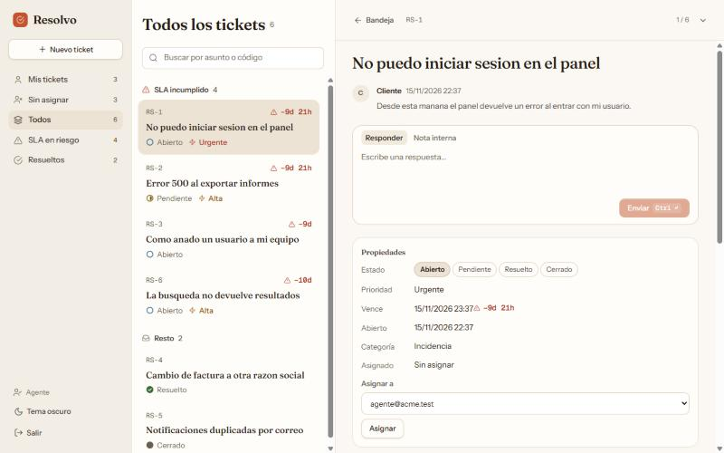
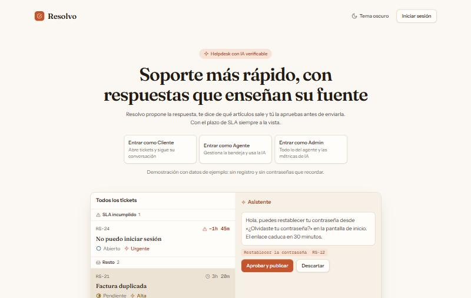
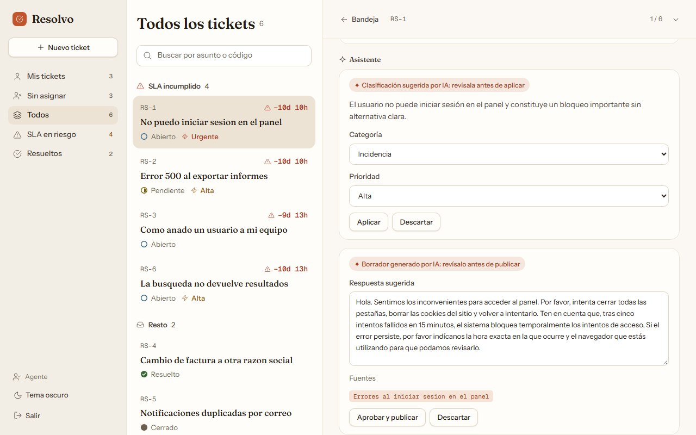
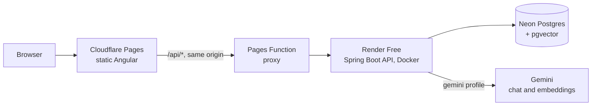

# Resolvo

[](https://github.com/Admaal/Resolvo/actions/workflows/ci.yml)

[Versión en español](README.md)

A multi-tenant B2B helpdesk for support teams, built solo as a portfolio project. The public demo runs on fictional data. The rest of the documentation is in Spanish: product in [docs/producto.md](docs/producto.md), technical decisions in [docs/adr/](docs/adr/).

**Live demo:** https://resolvo-6lc.pages.dev (one click to sign in as Customer, Agent or Admin; the UI is in Spanish)



| Landing page | Assistant citing its source |
| --- | --- |
|  |  |

## What it does

A customer opens a ticket; the team works it with SLAs, statuses and comments (public or internal). Each organization only sees its own data, and inside it a customer only sees and comments on their own tickets: asking for someone else's resource returns 404, the same as a missing one, so its existence never leaks. The inbox is grouped by SLA urgency, navigable with `J`/`K`, and tickets open by their code (`/tickets/RS-3`). Agents can hide a comment with a reason and only an admin can restore it; nothing is deleted. The session refreshes itself when the 15-minute access token expires.

AI helps, but never decides on its own:

- **Reply suggestions with citations (RAG).** Searches the organization's help articles and resolved tickets (pgvector, exact search scoped to the tenant) and drafts a reply that cites its sources. An agent edits and approves it; nothing reaches the customer before that.
- **Suggested classification.** Proposes category and priority; a person corrects it and applies it (the SLA is recalculated) or discards it.
- **Evals against the real model in CI.** A separate workflow measures priority and category accuracy, RAG recall, citations, tokens and latency against versioned thresholds ([ADR-0011](docs/adr/0011-evals.md)). Last recorded run: exact priority 96.9 %, category 100 %, recall@5 100 %.
- **Outbox and metrics.** Resolving or reopening a ticket writes an event in the same transaction, and an idempotent processor indexes or removes its fragments ([ADR-0008](docs/adr/0008-eventos.md)). `GET /api/metricas/ia` (admin only) reports calls, tokens, p50/p95 latency and list-price cost ([ADR-0012](docs/adr/0012-metricas-ia.md)).

## AI safety

Everything that reaches the model comes from a third party, so it is treated as hostile data ([ADR-0013](docs/adr/0013-seguridad-ia.md)):

- **Prompt injection.** Customer text and every RAG source go inside delimiters the text itself cannot close or reopen; the model may only cite sources the server retrieved, the category must exist in the catalogue and the draft is capped at 4000 characters.
- **Personal data.** Emails, phone numbers, Spanish ID numbers (with check letter), IBANs and card numbers (with Luhn) are masked before anything is sent to Gemini, for both chat and embeddings.
- **Rate limits.** 10 AI requests per user per minute and 5 login attempts per (email, client) every 15 minutes, answered with `429` and `Retry-After`. Account lockout was removed on purpose: with public demo accounts anyone could lock everyone out. The real client IP is sent by the Cloudflare Pages Function, signed with a shared key.
- **Daily budget.** Each organization has a per-day cap on calls and tokens (200 and 300,000 by default), enforced server-side.

## How it is built

A hexagonal modular monolith (Java 21, Spring Boot 3.5, Angular 22). `domain` and `application` import neither Spring nor JPA, enforced by ArchUnit in the gate ([ADR-0002](docs/adr/0002-arquitectura.md)). Every new class in those layers starts with a failing test, and PIT requires 80 % of mutants killed (last measured above 95 %). Integration tests run against real Postgres with Testcontainers. Local hooks and CI call the same script, and `main` only accepts pull requests with the `Gate obligatorio` check green ([ADR-0010](docs/adr/0010-tests-y-valla.md)).



Known limits: there are no browser end-to-end tests (the SPA is covered by component tests and manual checks on the demo); rate limits live in memory because Render Free runs a single instance; AI latency depends on Google's free models.

## The server sleeps

The API runs on Render's free plan, which stops it after 15 minutes without traffic. A ping every 5 minutes keeps it awake, but if it fails the first visit waits while the JVM starts (up to a minute). The UI says so ("Despertando servidor…") instead of hiding it.

## Running locally

Requirements: Java 21, Node, Docker.

```bash
docker run -d --name resolvo-pg -p 5432:5432 -e POSTGRES_DB=resolvo -e POSTGRES_USER=resolvo -e POSTGRES_PASSWORD=resolvo pgvector/pgvector:pg16
RESOLVO_JWT_SECRET=a-secret-of-at-least-32-bytes-xxxxxxxxxx backend/gradlew -p backend bootRun
cd frontend && npm install && npm start
```

Without a Gemini key the app works the same and the AI endpoints answer `503`. To enable AI, set `SPRING_PROFILES_ACTIVE=gemini` and `RESOLVO_GEMINI_API_KEY`. Deployment details are in the [Spanish README](README.md#despliegue-neon--render--cloudflare-pages).

## License

[PolyForm Noncommercial 1.0.0](LICENSE.md).
