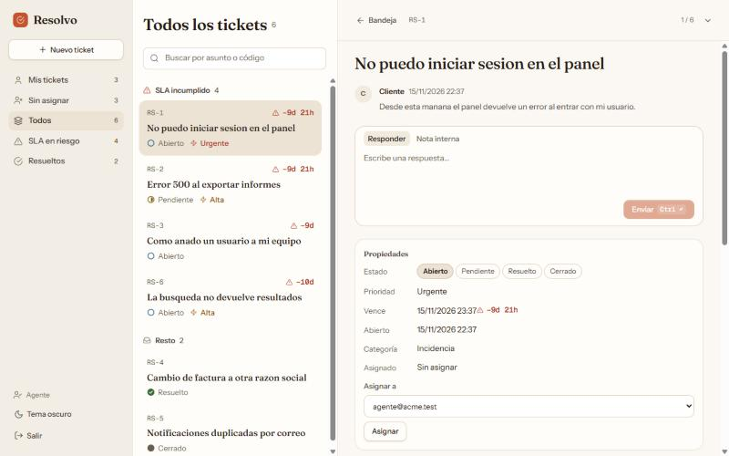
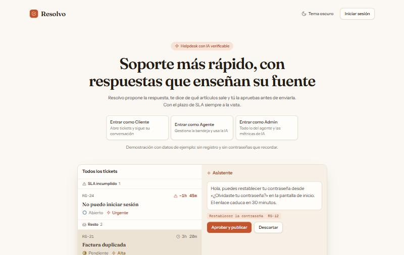
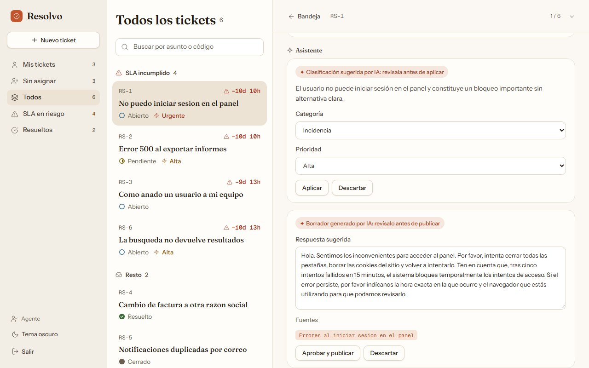
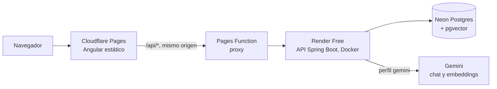

# Resolvo

[](https://github.com/Admaal/Resolvo/actions/workflows/ci.yml)

[English version](README.en.md)

Helpdesk B2B multi-tenant para equipos de soporte, hecho en solitario como proyecto de portfolio: la demo pública usa datos ficticios. El producto está en [docs/producto.md](docs/producto.md) y las decisiones técnicas en [docs/adr/](docs/adr/).

**Demo:** https://resolvo-6lc.pages.dev (entra con un clic como Cliente, Agente o Admin)



| Portada | Asistente con cita de la fuente |
| --- | --- |
|  |  |

## Qué hace

Un cliente abre un ticket; el equipo lo gestiona con SLA, estados y comentarios (públicos o internos). Cada organización solo ve lo suyo, y dentro de ella un cliente solo ve y comenta sus propios tickets: pedir un recurso ajeno da 404, igual que uno inexistente, sin delatar que existe. La bandeja se agrupa por urgencia de SLA, se navega con `J`/`K` y los tickets se abren por su código (`/tickets/RS-3`). Un agente puede ocultar un comentario con motivo (spam, ofensivo, otro) y solo un admin lo restaura; nada se borra. La sesión se renueva sola cuando caduca el token de 15 minutos. La IA ayuda, pero nunca decide sola:

- **Sugerencia de respuesta con citas (RAG).** Busca en los artículos de ayuda y los tickets resueltos de la propia organización (pgvector, búsqueda exacta) y redacta un borrador que cita sus fuentes. Un agente lo edita y lo aprueba; hasta entonces no sale nada al cliente.
- **Clasificación sugerida.** Propone categoría y prioridad; la persona la corrige y la aplica (recalcula el SLA) o la descarta.
- **Evals contra el modelo real en CI.** Un workflow aparte mide acierto de prioridad y categoría, recall del RAG, citas, tokens y latencia con umbrales versionados ([ADR-0011](docs/adr/0011-evals.md)). Última corrida registrada: prioridad exacta 96,9 %, categoría 100 %, recall@5 100 %.
- **Outbox y métricas.** Resolver o reabrir un ticket escribe un evento en la misma transacción y un procesador idempotente indexa o borra sus fragmentos ([ADR-0008](docs/adr/0008-eventos.md)). `GET /api/metricas/ia` (ADMIN) resume llamadas, tokens, p50/p95 y coste a precio de lista ([ADR-0012](docs/adr/0012-metricas-ia.md)).

## Seguridad de la IA (fase 6)

Todo lo que llega al modelo viene de un tercero, así que se trata como dato hostil ([ADR-0013](docs/adr/0013-seguridad-ia.md)):

- **Prompt injection.** El texto del cliente y cada fuente del RAG van entre delimitadores (`<ticket>`, `<fuente id="…">`) que el propio texto no puede cerrar ni reabrir; el prompt dice que lo de dentro son datos, no órdenes. Además, el modelo solo puede citar fuentes que el servidor recuperó, la categoría debe existir en el catálogo y el borrador se recorta a 4000 caracteres.
- **Datos personales.** Emails, teléfonos, DNI/NIE (con su letra de control), IBAN y tarjetas (con Luhn) se sustituyen por marcadores antes de enviar nada a Gemini, tanto al redactar y clasificar como al calcular embeddings.
- **Límites de uso.** Máximo 10 peticiones de IA por usuario y minuto, y 5 intentos de login por (email, cliente) en 15 minutos, con `429` y `Retry-After`. El bloqueo de cuenta se retiró porque, con cuentas de demo públicas, cualquiera podía dejar a todos fuera; la IP real del cliente la manda la Pages Function firmada con una clave compartida, porque Cloudflare entrega a Render la IP del Worker, igual para todos.
- **Presupuesto diario.** Cada organización tiene un tope de llamadas y de tokens por día UTC (200 y 300 000 por defecto) comprobado en el servidor y que cuenta las llamadas de chat (sugerir y clasificar), no los embeddings; al superarlo, `429 ia-presupuesto-agotado`. Los límites viven en memoria porque Render Free corre una sola instancia.

## Cómo se construye

Monolito modular hexagonal (Java 21, Spring Boot 3.5, Angular 22): `domain` y `application` no importan Spring ni JPA y lo comprueba ArchUnit en el gate ([ADR-0002](docs/adr/0002-arquitectura.md)). Cada clase nueva de esas capas nace con un test en rojo y PIT exige un 80 % de mutantes muertos (la última medición, por encima del 95 %); los tests de integración corren contra Postgres real con Testcontainers. Hooks y CI llaman al mismo script y `main` solo acepta PRs con el check `Gate obligatorio` en verde ([ADR-0010](docs/adr/0010-tests-y-valla.md), [AGENTS.md](AGENTS.md)). El historial de fases está en [docs/fases.md](docs/fases.md) y la dirección visual en [docs/design.md](docs/design.md).

Límites conocidos, a propósito o pendientes: no hay tests end to end de navegador (la SPA se cubre con tests de componente y comprobaciones a mano en la demo); los límites de uso viven en memoria porque Render Free corre una sola instancia; y la latencia de la IA depende del modelo gratuito de Google (p95 de los evals entre 1,5 y 12,7 s según la corrida).



## Entrar a la demo

Organización Acme. Contraseña de los tres usuarios: `demo-resolvo`.

| Usuario | Rol |
| --- | --- |
| `cliente@acme.test` | CLIENTE |
| `agente@acme.test` | AGENTE |
| `admin@acme.test` | ADMIN |

## Aviso: el servidor se duerme

La API corre en el plan gratuito de Render, que la apaga tras 15 minutos sin tráfico. Un único ping cada 5 minutos la mantiene despierta, pero si falla, la primera visita espera mientras la JVM arranca (hasta un minuto). La interfaz lo avisa con «Despertando servidor…» en vez de esconderlo. La base de datos (Neon) se apaga sola y despierta con la siguiente consulta, sin ping.

## Despliegue: proxy de mismo origen

La SPA y la API comparten origen gracias al proxy: no hay CORS y la cookie de refresh sigue siendo `HttpOnly`, `SameSite=Lax` y `Path=/api/sesion`.

## Local

Requisitos: Java 21, Node, Docker (Postgres y los tests `full`).

```bash
docker run -d --name resolvo-pg -p 5432:5432 -e POSTGRES_DB=resolvo -e POSTGRES_USER=resolvo -e POSTGRES_PASSWORD=resolvo pgvector/pgvector:pg16
RESOLVO_JWT_SECRET=un-secreto-de-al-menos-32-bytes-xxxxxxxx backend/gradlew -p backend bootRun
cd frontend && npm install && npm start
```

Tests: `powershell -NoProfile -File scripts/gates.ps1 full`. Más comandos en [AGENTS.md](AGENTS.md).

### IA (opcional)

Sin clave la app funciona igual: las sugerencias y el reindexado responden `503` con `ia-no-configurada`. Para encenderla, una clave de Gemini (free tier) y el perfil `gemini`. El perfil exige la clave: sin ella el arranque falla diciendo qué variable falta; si quieres la IA apagada, no actives el perfil.

```bash
SPRING_PROFILES_ACTIVE=gemini RESOLVO_GEMINI_API_KEY=<tu-clave> RESOLVO_JWT_SECRET=... backend/gradlew -p backend bootRun
```

Al arrancar se indexan en segundo plano los artículos de ayuda y los tickets resueltos; un ADMIN puede forzarlo con `POST /api/conocimiento/reindexar`. La clave solo se lee de la variable de entorno.

**Modelos de redacción.** Google retira o satura modelos concretos. Al arrancar, la app sondea todos los de la lista a la vez, anota en el log cuánto tarda cada uno y pone primero los que responden. En cada petición prueba hasta 3 por ese orden y pasa al siguiente si uno da 404 (retirado), 503 (saturado), cuota agotada o no contesta en 15 s. Un 403 (clave o permisos) no se reintenta con otro modelo. La lista por defecto es `gemini-flash-lite-latest,gemini-3.5-flash-lite,gemini-3.1-flash-lite,gemini-flash-latest,gemini-3.5-flash,gemini-3.8-flash` y se cambia con `RESOLVO_GEMINI_MODELOS` (separados por comas), sin tocar el código. Los embeddings van fijos con `gemini-embedding-001` a 768 dimensiones (ADR-0007).

El log de arranque dice qué modelos responden y en cuánto tiempo (`Gemini sondeo: X responde en N ms`) o, si ninguno, el motivo de cada uno. Es la forma de comprobar la clave y los modelos sin iniciar sesión.

## Despliegue (Neon + Render + Cloudflare Pages)

1. **Neon:** proyecto y base de datos. Guarda dos cadenas: la _pooled_ (para la app) y la _directa_ (para migrar).
2. **Render:** Web Service con Docker desde este repo, directorio raíz `backend`, health check `/api/salud`. Variables:

   | Variable | Valor |
   | --- | --- |
   | `RESOLVO_DB_URL` | JDBC del endpoint pooled de Neon, con `sslmode=require` |
   | `RESOLVO_DB_USER` / `RESOLVO_DB_PASSWORD` | credenciales de Neon |
   | `RESOLVO_DB_MIGRATION_URL` / `_USER` / `_PASSWORD` | lo mismo con la conexión directa (Flyway) |
   | `RESOLVO_JWT_SECRET` | secreto generado, al menos 32 bytes |
   | `RESOLVO_COOKIE_SECURE` | `true` |
   | `SPRING_PROFILES_ACTIVE` / `RESOLVO_GEMINI_API_KEY` | `gemini` y la clave; sin ellas la IA queda apagada |
   | `RESOLVO_IA_LLAMADAS_DIA` / `RESOLVO_IA_TOKENS_DIA` | opcionales: presupuesto diario de IA por organización (200 y 300000) |
   | `RESOLVO_PROXY_CLAVE` | clave compartida con la Pages Function (la misma que el secreto `PROXY_CLAVE` de Pages: `npx wrangler pages secret put PROXY_CLAVE --project-name resolvo`); sin ella el límite de login cuenta a todos los clientes como uno |
   | `RESOLVO_LIMITE_IA_POR_MINUTO` / `RESOLVO_LIMITE_LOGIN_FALLOS` | opcionales: peticiones de IA por usuario y minuto (10) y fallos de login por 15 min (5) |
   | `RESOLVO_LIMITE_COMENTARIOS_POR_MINUTO` | opcional: comentarios por usuario y minuto (10) |
   | `RESOLVO_DEMO_PURGAR_COMENTARIOS` | `true` en la demo pública: borra al arrancar y cada 24 h los comentarios de visitantes de más de 24 h (los de la semilla se conservan) |

3. **Cloudflare Pages:** proyecto `resolvo` de subida directa (no está conectado a Git). El workflow [despliegue.yml](.github/workflows/despliegue.yml) lo despliega cuando cambia `frontend/` en `main` (o a mano desde Actions); necesita los secretos de GitHub `CLOUDFLARE_API_TOKEN` (permiso Cloudflare Pages: Edit) y `CLOUDFLARE_ACCOUNT_ID`, y sin ellos termina en verde sin desplegar. A mano, desde `frontend/`: `npm run build && npx wrangler pages deploy --project-name resolvo --branch main` (con `--branch main`, o sale como preview). Las Pages Functions de `frontend/functions` van en el mismo despliegue. Variable `API_ORIGIN` = URL del servicio de Render (sin barra final), ya definida en `wrangler.toml`.
4. **Ping:** el workflow [ping.yml](.github/workflows/ping.yml) de GitHub Actions llama cada 5 minutos a `GET <URL de Render>/api/salud`. Ningún otro servicio en Render: 744 h/mes caben en las 750 h del plan.

Los secretos viven solo en las variables de Render y Pages, nunca en el repositorio.

## Licencia

[PolyForm Noncommercial 1.0.0](LICENSE.md).
